<h1 align="center">
  <picture>
    <source media="(prefers-color-scheme: dark)" srcset="./branding/bookside-logo-dark.svg">
    
  </picture>
</h1>

<p align="center">
  <a href="https://hub.docker.com/r/cwndev/bookside"></a>
  <a href="https://github.com/cwn-dev/
  bookside/releases/latest"></a>
  <a href="https://github.com/cwn-dev/bookside/actions/workflows/build-and-test.yml"></a>
</p>

<p align="center">
  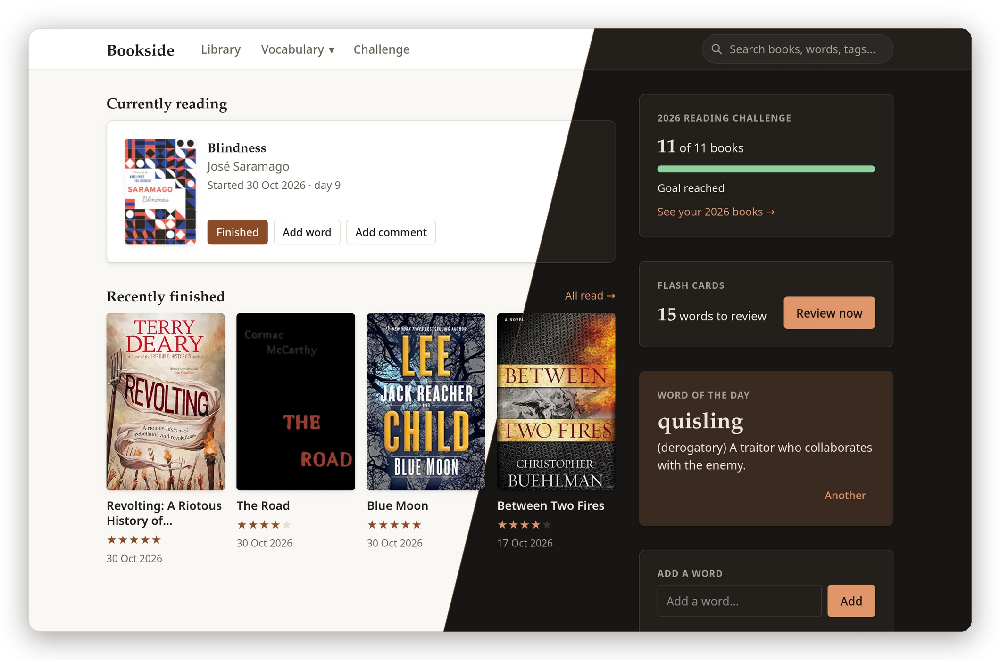
</p>

Bookside is a self-hosted reading companion. It keeps your library of books, with covers, authors, series and tags, and imports details by ISBN, title or author from Open Library (or Google Books). For each book you log when you started and finished it, rate it and keep running reading notes. Words you meet while reading go into a vocabulary list, linked to the book, page and sentence they came from, with definitions fetched automatically. A home page brings together what you're reading now, recently finished books, recent words, a word of the day and reading stats. A search box in the header finds books, words, tags and comments as you type.

I like to think this is not just is not just some heartless AI creation.  All the code is written by Claude, but I like to think I add some human to it. I check everything he does before it's committed and give it, hopefully, a more human touch.  The UX/architecture/tech stack was the outcome of a conversation with Claude about the best way to go - I picked C# & .NET as I've been using that stack for close to 20 years now, and Claude suggested Blazor. I work well with Claude, directing him to an actually good output as I know what's going on!

This is just a project for fun, mainly to play with Claude honestly - I love new tech & have been a developer for decades so am always curious. Also, I've always wanted to get away from GoodReads, and this did it.

The CI setup is human developed and run (apart from that time Claude updated the action versions for me - nice!).

## Desktop Browser UI

<sub>These follow your GitHub theme, light or dark. Every screen in both themes is in [screenshots](./screenshots/).</sub>

<table>
  <tr>
    <td width="50%" align="center" valign="top">
      <a href="./screenshots/desktop/light/home.webp"><picture><source media="(prefers-color-scheme: dark)" srcset="./screenshots/desktop/dark/home.webp">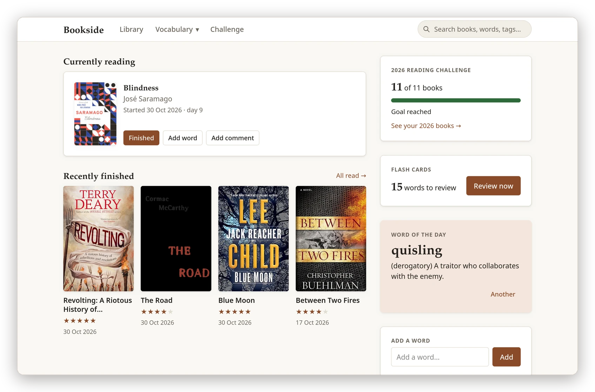</picture></a><br>
      <sub>Home</sub>
    </td>
    <td width="50%" align="center" valign="top">
      <a href="./screenshots/desktop/light/library.webp"><picture><source media="(prefers-color-scheme: dark)" srcset="./screenshots/desktop/dark/library.webp">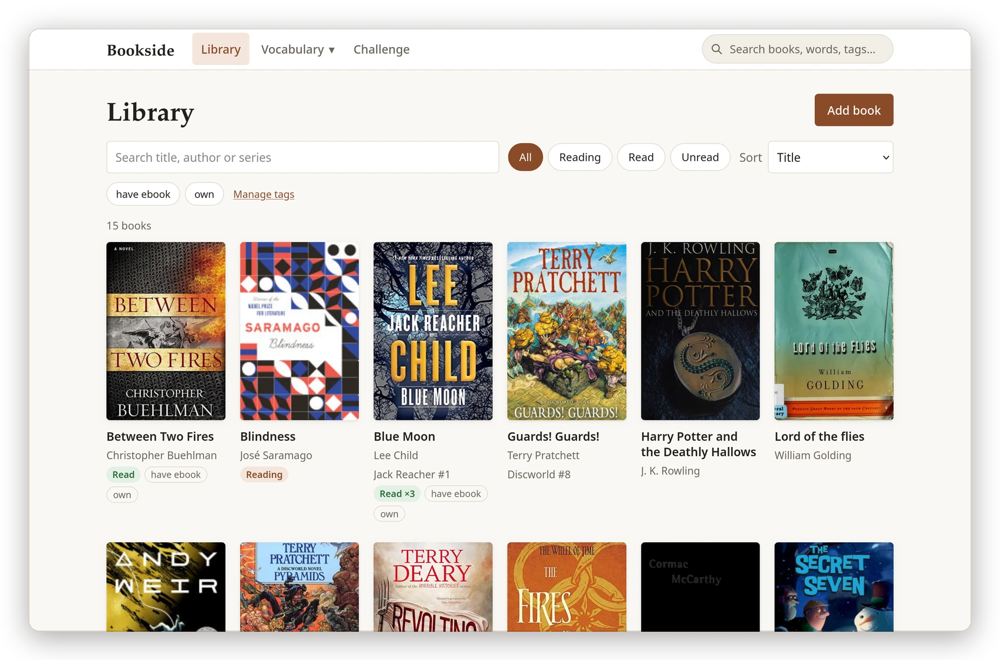</picture></a><br>
      <sub>Library</sub>
    </td>
  </tr>
  <tr>
    <td width="50%" align="center" valign="top">
      <a href="./screenshots/desktop/light/book.webp"><picture><source media="(prefers-color-scheme: dark)" srcset="./screenshots/desktop/dark/book.webp"></picture></a><br>
      <sub>Book details</sub>
    </td>
    <td width="50%" align="center" valign="top">
      <a href="./screenshots/desktop/light/reading-log.webp"><picture><source media="(prefers-color-scheme: dark)" srcset="./screenshots/desktop/dark/reading-log.webp">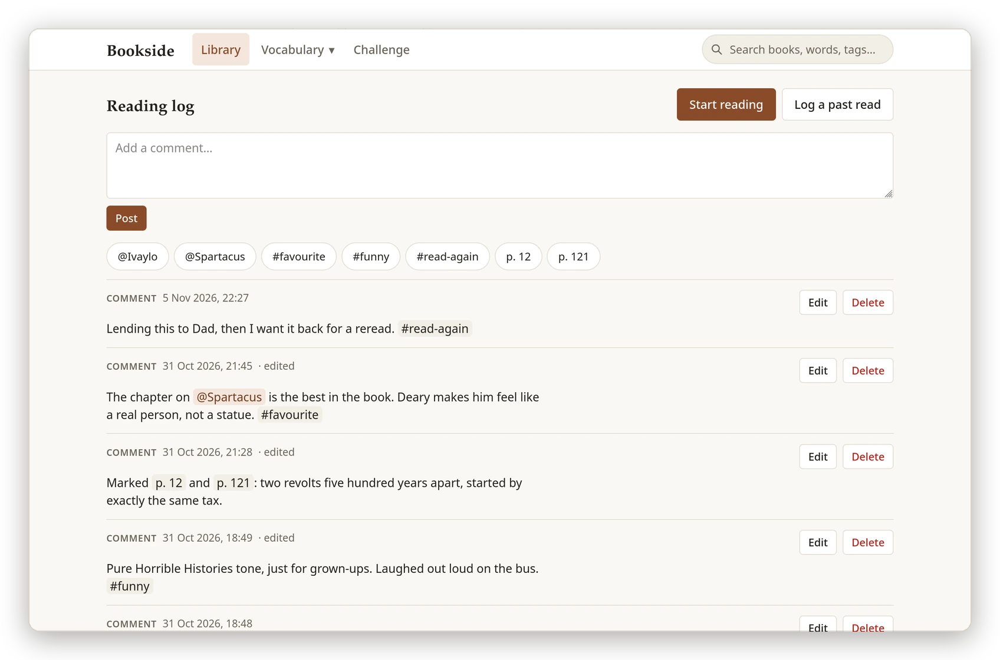</picture></a><br>
      <sub>Reading log with tagged notes</sub>
    </td>
  </tr>
  <tr>
    <td width="50%" align="center" valign="top">
      <a href="./screenshots/desktop/light/challenge.webp"><picture><source media="(prefers-color-scheme: dark)" srcset="./screenshots/desktop/dark/challenge.webp">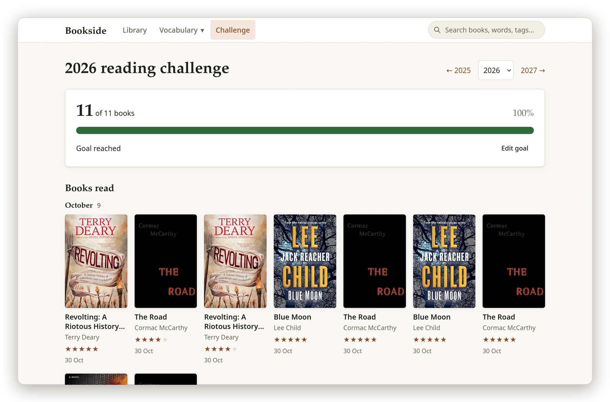</picture></a><br>
      <sub>Reading challenge</sub>
    </td>
    <td width="50%" align="center" valign="top">
      <a href="./screenshots/desktop/light/search.webp"><picture><source media="(prefers-color-scheme: dark)" srcset="./screenshots/desktop/dark/search.webp">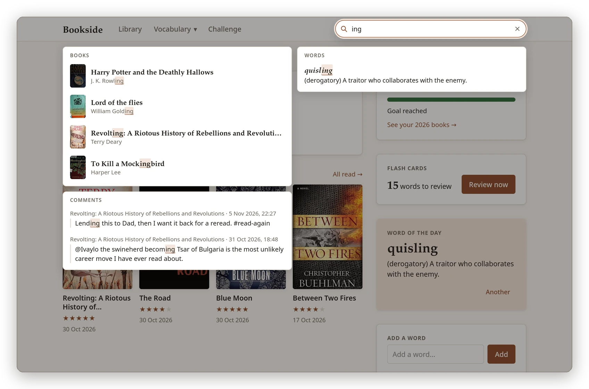</picture></a><br>
      <sub>Global search</sub>
    </td>
  </tr>
  <tr>
    <td width="50%" align="center" valign="top">
      <a href="./screenshots/desktop/light/vocabulary.webp"><picture><source media="(prefers-color-scheme: dark)" srcset="./screenshots/desktop/dark/vocabulary.webp">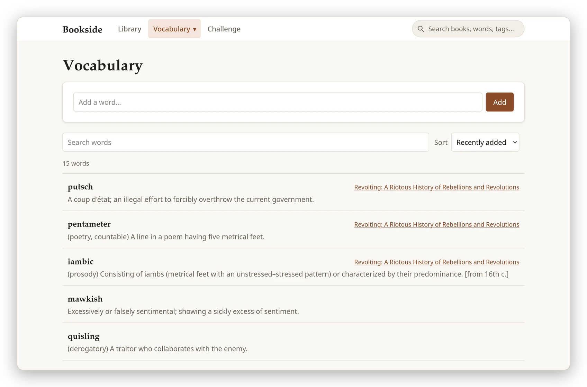</picture></a><br>
      <sub>Vocabulary</sub>
    </td>
    <td width="50%" align="center" valign="top">
      <a href="./screenshots/desktop/light/add-book.webp"><picture><source media="(prefers-color-scheme: dark)" srcset="./screenshots/desktop/dark/add-book.webp">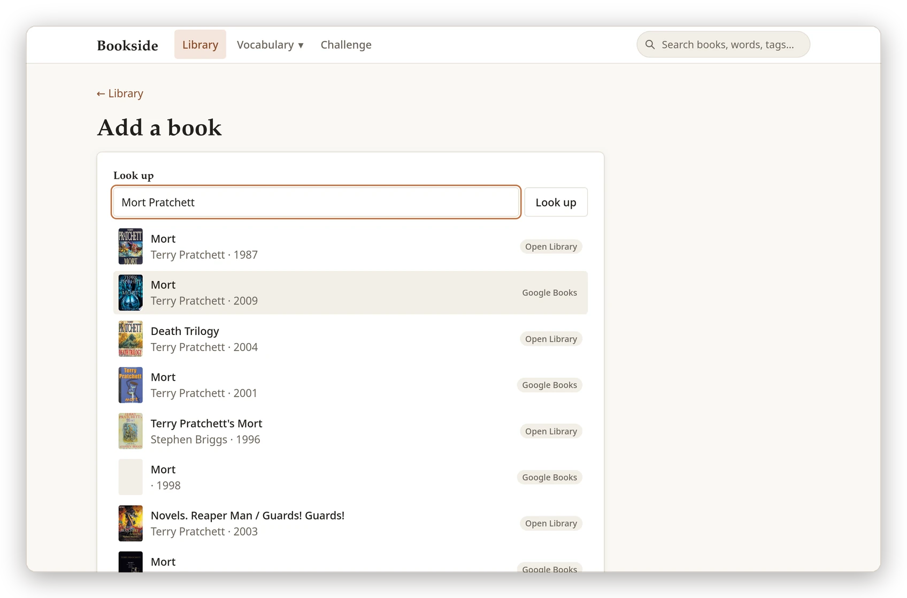</picture></a><br>
      <sub>Add a book: Open Library / Google Books lookup</sub>
    </td>
  </tr>
  <tr>
    <td width="50%" align="center" valign="top">
      <a href="./screenshots/desktop/light/word.webp"><picture><source media="(prefers-color-scheme: dark)" srcset="./screenshots/desktop/dark/word.webp">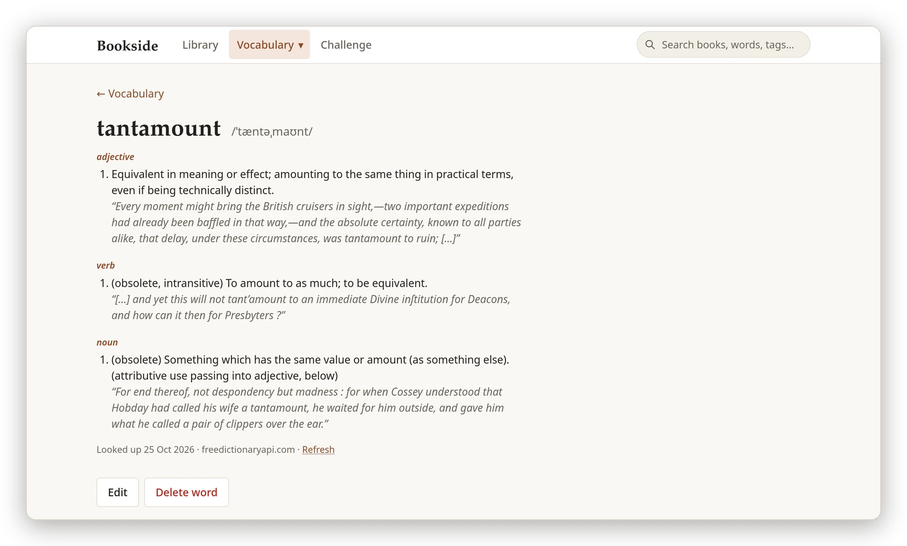</picture></a><br>
      <sub>Word details</sub>
    </td>
    <td width="50%" align="center" valign="top">
      <a href="./screenshots/desktop/light/review.webp"><picture><source media="(prefers-color-scheme: dark)" srcset="./screenshots/desktop/dark/review.webp">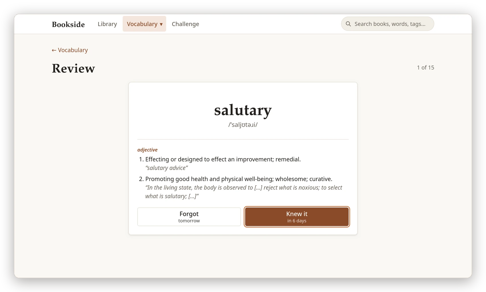</picture></a><br>
      <sub>Flash card review</sub>
    </td>
  </tr>
</table>

## Mobile Browser UI

<table>
  <tr>
    <td width="25%" align="center" valign="top">
      <a href="./screenshots/mobile/light/home.webp">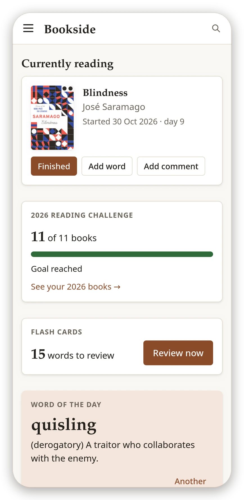</a><br>
      <sub>Home</sub>
    </td>
    <td width="25%" align="center" valign="top">
      <a href="./screenshots/mobile/dark/search.webp">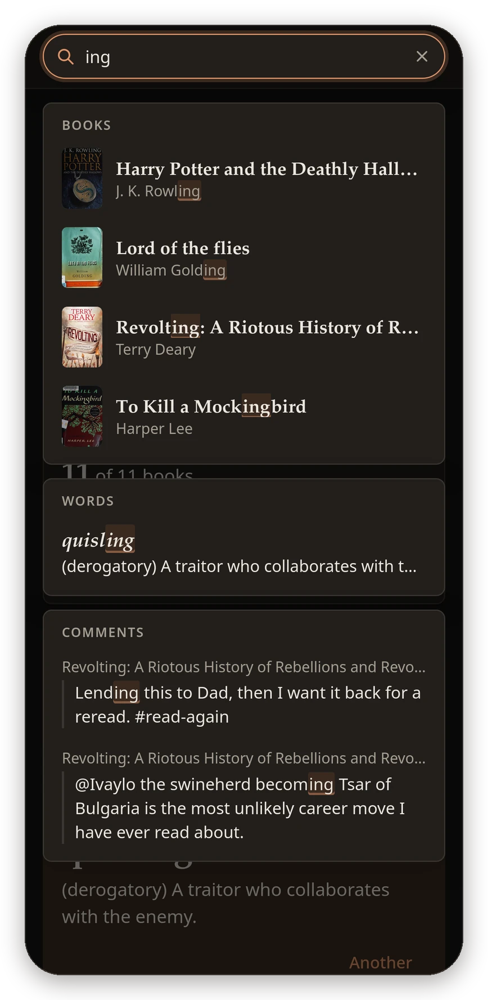</a><br>
      <sub>Search</sub>
    </td>
    <td width="25%" align="center" valign="top">
      <a href="./screenshots/mobile/light/reading-log.webp">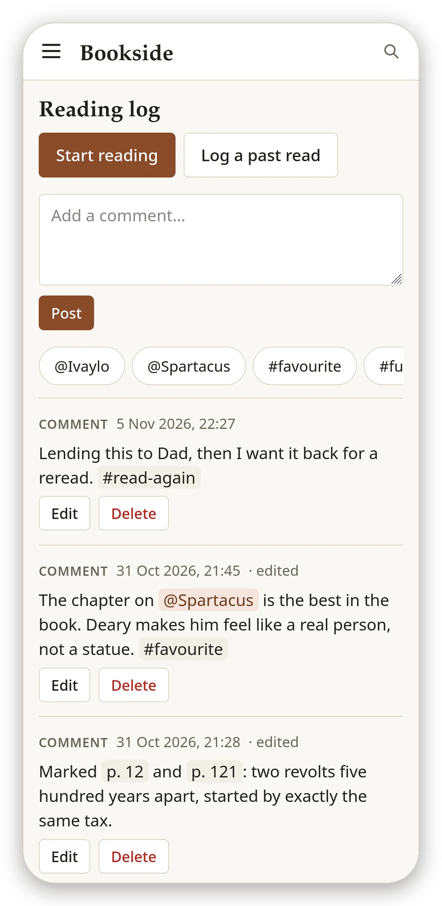</a><br>
      <sub>Reading log</sub>
    </td>
    <td width="25%" align="center" valign="top">
      <a href="./screenshots/mobile/dark/word.webp">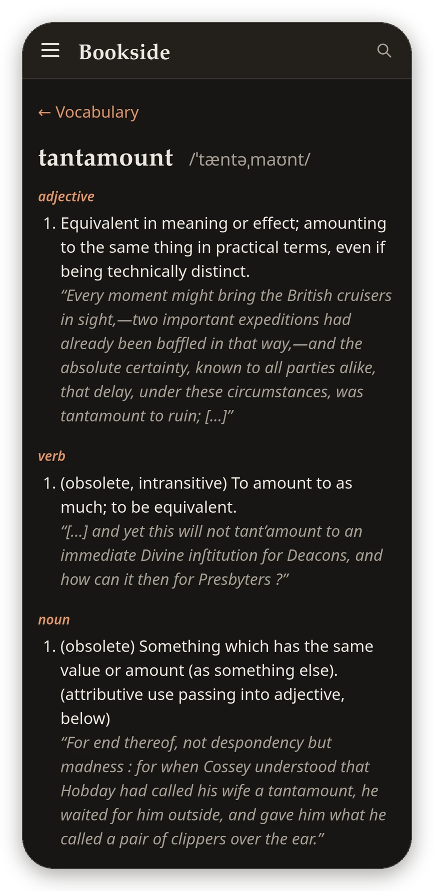</a><br>
      <sub>Word details</sub>
    </td>
  </tr>
</table>

[More screenshots](./screenshots/): desktop and mobile, light and dark.

## Features

* Home page with 'currently reading', 'recently finished', 'recent words', 'word of the day' and reading statistics.
* Track your book collection in the Library section.
* Log when you started/finished a book, give it a rating, and leave comments (multiple comments can be left and act as a reading notes companion).
* Log new words you come across in the Vocabulary section to revisit later.
* Link a new word to a book.
* Word definition is looked up using multiple providers when adding a new word to the dictionary.
* Look up book metadata using Open Library or Google Books API (you'll need your own key, which is free).
* Automatic cover download.
* Books can be tagged with as many tags as you need - you could tag the genre, wishlist, own, etc. (the read/reading tags are separate to these).
* Vocabulary flashcards to help learn and remember definitions. You will be given 15 words to review per day. Click 'Forgot' (the word will show up again tomorrow) or 'Knew it' (the word won't show up for a couple of days). The scheduling for words to appear for review is SM-2 like in that 'Forgot' will reduce the ease and so the word is shown more frequently over time and 'Knew it' will increase the ease so the word is shown less frequently over time.
* Vocabulary flash card practise mode - after your daily review, you can go back into the 'Review' section to practise with one of the three modes: forgotten today, random words, and most forgotten.
* Set yourself a reading challenge for the year and see your progress on the home page.
* Comment tagging system (under prototyping/development).
* HTTP API for adding words from scripts, shortcuts or anything that can send an HTTP request (see "API" below).
* Global search in the header: finds books (by title, author or series), words, tags and comments as you type, with the matches highlighted. Use the keyboard to move through the results and "See all" to open the full library or vocabulary results.

## Docker

Run the published image from Docker Hub (multi-arch: `linux/amd64`, `linux/arm64`):

```bash
mkdir -p bookside_data && sudo chown 1654:1654 bookside_data   # the image runs as UID 1654
docker run -d --name bookside --restart unless-stopped \
  -p 8080:8080 \
  -v "$PWD/bookside_data:/data" \
  -e TZ=Europe/London \
  -e ASPNETCORE_FORWARDEDHEADERS_ENABLED=true \
  --stop-timeout 30 \
  cwndev/bookside:latest
```

The app listens on port 8080. Optional settings, as extra `-e` flags:

- `Bookside__GoogleBooks__ApiKey=<key>`: Google Books as a fallback for book lookups (Open Library is always used).
- `Bookside__ApiToken=<token>`: turns the HTTP API on (see "API"), e.g. from `openssl rand -hex 32`.

- **Update:** `docker pull cwndev/bookside:latest && docker rm -f bookside`, then the same `docker run`
  (migrations run at startup; the data stays in `bookside_data/`).
- **Logs:** `docker logs -f bookside`.

## Docker Compose

To run the published image from Docker Hub without cloning the repo, create a folder with this
`docker-compose.yaml`:

```yaml
services:
  bookside:
    image: cwndev/bookside:latest
    container_name: bookside
    restart: unless-stopped
    ports:
      - 8080:8080
    volumes:
      - ./bookside_data:/data
    environment:
      TZ: ${TZ:-Etc/UTC}
      # Trust X-Forwarded-For/-Proto from the reverse proxy.
      ASPNETCORE_FORWARDEDHEADERS_ENABLED: "true"
      # Optional: Google Books as a fallback for book lookups. Empty = not used.
      Bookside__GoogleBooks__ApiKey: ${GOOGLE_BOOKS_API_KEY:-}
      # Optional: bearer token for the HTTP API (/api). Empty = API off.
      Bookside__ApiToken: ${BOOKSIDE_API_TOKEN:-}
    stop_grace_period: 30s
```

and a `.env` file next to it:

```bash
TZ=Europe/London
# GOOGLE_BOOKS_API_KEY=...
# BOOKSIDE_API_TOKEN=...   # e.g. from `openssl rand -hex 32`
```

Then:

```bash
mkdir -p bookside_data && sudo chown 1654:1654 bookside_data   # the image runs as UID 1654
docker compose up -d
```

- **Update:** `docker compose pull && docker compose up -d` (migrations run at startup).
- **Logs:** `docker compose logs -f bookside`.
- **Data, backup, reverse proxy:** see "Deploy from source (Docker)" below.

## API

Endpoints under `/api` on the same host and port as the web UI. They are off until a token is set
(`Bookside__ApiToken` with `docker run`, `BOOKSIDE_API_TOKEN` in `.env` with Compose; in development
`dotnet user-secrets set Bookside:ApiToken <token> --project src/Bookside.Web`). Every request needs
`Authorization: Bearer <token>`; a missing or wrong token gets 401.

**`POST /api/words`** adds a word to the vocabulary list and looks up its definition.

```bash
curl -H "Authorization: Bearer $TOKEN" -H "Content-Type: application/json" \
  -d '{"term": "petrichor", "book": "Dune", "pageNumber": 42, "context": "the smell of rain"}' \
  https://bookside.example/api/words
```

Only `term` is required. Optional: `language` (default `en`), `context` (the sentence), `pageNumber`, `notes`, and
the book as either `book` (exact title, any case) or `bookId`.

- `201 Created`: the new word (JSON) with its definition, `Location: /words/{id}`.
- `200 OK`: the word was already on the list; returns the existing one, so resending is safe.
- `400`: validation errors as ProblemDetails, e.g. `{"errors": {"book": ["No book titled \"Emma\"."]}}`.

## KOReader plugin

`koreader/bookside.koplugin` pushes words saved by KOReader's Vocabulary Builder to `POST /api/words`, with the
text around the word as `context` and the book's title as `book` (no matching book in Bookside = added without one).

1. Copy the `bookside.koplugin` folder into KOReader's `plugins/` folder and restart KOReader.
2. Tools → Bookside → Server settings: the server address (e.g. `https://bookside.example`) and the API token.
3. Tools → Bookside → Push vocabulary.

Only words added since the last push are sent (the time is kept in KOReader's `settings/bookside.lua`). Tap
"Last pushed" to send everything again; words Bookside already has are skipped.

## Deploy from source (Docker)

One container, SQLite in `./bookside_data` on the Docker host, plain HTTP behind a reverse proxy that terminates TLS.

```bash
git clone <repo> bookside && cd bookside
mkdir -p bookside_data && sudo chown 1654:1654 bookside_data   # the image runs as the non-root `app` user (UID 1654)
echo "TZ=Europe/London" > .env   # server time zone: "today" for reading dates, reading-log times
docker compose up -d --build
```

- **Data:** `bookside_data/bookside.db` (+ `-wal`/`-shm`) and `bookside_data/keys/` (ASP.NET Core Data Protection
  keys, stored unencrypted: keep the folder private). `bookside_data/` must be on a local filesystem (SQLite WAL doesn't work on NFS/SMB).
- **Backup:** stop the container and copy `bookside_data/`, or while it runs:
  `sqlite3 bookside_data/bookside.db ".backup backup.db"`
  (copying only `bookside.db` while it runs can miss changes still in the WAL file).
- **Port:** published on 8080 on all interfaces. `X-Forwarded-For`/`-Proto` are trusted from any client, so keep
  the port reachable only by the proxy (e.g. with a firewall).
- **Reverse proxy:** must pass WebSockets (Blazor Server), e.g. nginx needs `proxy_http_version 1.1` plus the
  `Upgrade`/`Connection` headers; Caddy and Traefik do it by default.
- **Book lookup:** Open Library needs no key. To add Google Books as a fallback, put `GOOGLE_BOOKS_API_KEY=…` in
  `.env` (a Google Cloud API key with the Books API enabled). In development:
  `dotnet user-secrets set Bookside:GoogleBooks:ApiKey <key> --project src/Bookside.Web`.
- **API:** off until you set a token: `BOOKSIDE_API_TOKEN=$(openssl rand -hex 32)` in `.env` (see "API").
- **No authentication for the web UI yet:** don't expose it beyond your LAN/VPN.
- **Update:** `git pull && docker compose up -d --build` (migrations run at startup).

## Layout

| Project | Role |
|---|---|
| `src/Bookside.Core` | Entities, domain rules, service contracts + DTOs, `Result` types. No EF/HTTP dependencies. |
| `src/Bookside.Data` | Provider-agnostic EF Core model (`BooksideDbContext`, configurations, save rules) and service implementations (`AddBooksideServices`). |
| `src/Bookside.Data.Sqlite` | SQLite wiring (`AddBooksideSqlite`, `InitializeBooksideDatabaseAsync`), migrations, design-time factory. |
| `tests/Bookside.Data.Tests` | xUnit v3 tests against real temp SQLite files. |

Also `src/Bookside.Integrations` (dictionary clients), `src/Bookside.UI` (Razor class library), `src/Bookside.Web`
(Blazor Web App host), `src/Bookside.Api` (HTTP API, mapped by the Web host) and their test projects; see CLAUDE.md.
Planned: `Bookside.App` (MAUI Blazor Hybrid).

## Commands

```bash
dotnet tool restore
dotnet build
dotnet test

# Add a migration after changing the model
dotnet ef migrations add <Name> --project src/Bookside.Data.Sqlite

# Generate the SQL for review
dotnet ef migrations script --project src/Bookside.Data.Sqlite
```

Hosts apply migrations at startup via `services.InitializeBooksideDatabaseAsync()`.
