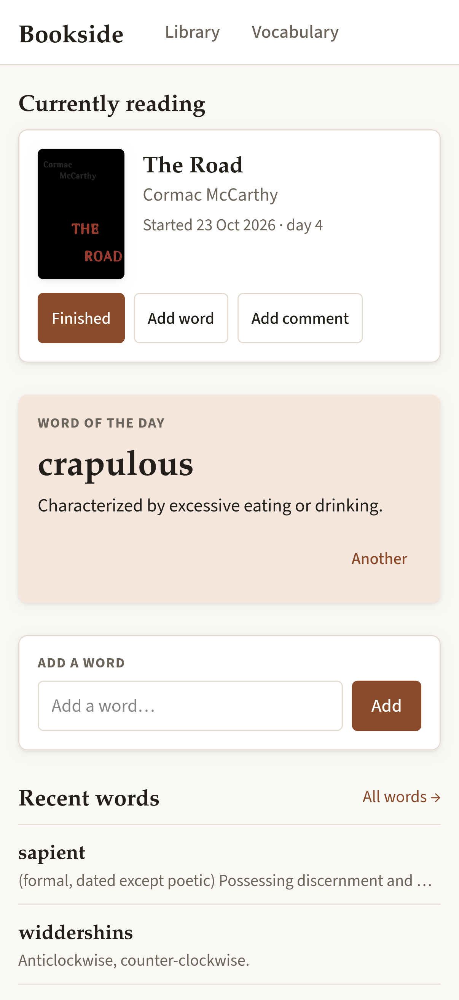

# Bookside

Bookside is a self-hosted reading companion. It keeps your library of books, with covers, authors, series and tags, and imports details by ISBN, title or author from Open Library (or Google Books). For each book you log when you started and finished it, rate it and keep running reading notes. Words you meet while reading go into a vocabulary list, linked to the book, page and sentence they came from, with definitions fetched automatically. A home page brings together what you're reading now, recently finished books, recent words, a word of the day and reading stats.

## Desktop Browser UI

<p align="center">
  <a href="./screenshots/Screenshot%202026-10-26%20at%2020-41-22%20Bookside.png"></a>
  <a href="./screenshots/Screenshot%202026-10-26%20at%2020-41-57%20The%20Colour%20of%20Magic%20%C2%B7%20Bookside.png"></a>
  <a href="./screenshots/Screenshot%202026-10-26%20at%2020-41-35%20Vocabulary%20%C2%B7%20Bookside.png"></a>
</p>

<p align="center">
  <a href="./screenshots/Screenshot%202026-10-26%20at%2020-44-28%20Vocabulary%20%C2%B7%20Bookside.png"></a>
  <a href="./screenshots/Screenshot%202026-10-26%20at%2020-41-44%20sapient%20%C2%B7%20Bookside.png"></a>
</p>

<p align="center">
  <a href="./screenshots/Screenshot%202026-10-26%20at%2020-43-44%20Add%20book%20%C2%B7%20Bookside.png"></a>
  <a href="./screenshots/Screenshot%202026-10-26%20at%2020-44-00%20Add%20book%20%C2%B7%20Bookside.png"></a>
</p>

## Mobile Browser UI

<p align="center">
  <a href="./screenshots/mobile/home.png"></a>
  <a href="./screenshots/mobile/a%20book.png"></a>
  <a href="./screenshots/mobile/reading%20log.png"></a>
  <a href="./screenshots/mobile/voacbulary%20entry.png"></a>
</p>

[More screenshots](./screenshots/)

## Features

* Home page with 'currently reading', 'recently finished', 'recent words', 'word of the day' and reading statistics.
* Track your book collection in the Library section.
* Log when you started/finished a book, give it a rating, and leave comments (multiple comments can be left and act as a reading notes companion).
* Log new words you come across in the Vocabulary section to revisit later.
* Link a new word to a book.

## Layout

| Project | Role |
|---|---|
| `src/Bookside.Core` | Entities, domain rules, service contracts + DTOs, `Result` types. No EF/HTTP dependencies. |
| `src/Bookside.Data` | Provider-agnostic EF Core model (`BooksideDbContext`, configurations, save rules) and service implementations (`AddBooksideServices`). |
| `src/Bookside.Data.Sqlite` | SQLite wiring (`AddBooksideSqlite`, `InitializeBooksideDatabaseAsync`), migrations, design-time factory. |
| `tests/Bookside.Data.Tests` | xUnit v3 tests against real temp SQLite files. |

Also `src/Bookside.Integrations` (dictionary clients), `src/Bookside.UI` (Razor class library), `src/Bookside.Web`
(Blazor Web App host) and their test projects; see CLAUDE.md. Planned: `Bookside.Api` + `Bookside.App` (MAUI Blazor Hybrid).

## Commands

```bash
dotnet tool restore
dotnet build
dotnet test

# Add a migration after changing the model
dotnet ef migrations add <Name> --project src/Bookside.Data.Sqlite

# Generate the SQL for review
dotnet ef migrations script --project src/Bookside.Data.Sqlite
```

Hosts apply migrations at startup via `services.InitializeBooksideDatabaseAsync()`.

## Deploy (Docker)

One container, SQLite in `./data` on the Docker host, plain HTTP behind a reverse proxy that terminates TLS.

```bash
git clone <repo> bookside && cd bookside
mkdir -p data && sudo chown 1654:1654 data   # the image runs as the non-root `app` user (UID 1654)
echo "TZ=Europe/London" > .env               # server time zone: "today" for reading dates, reading-log times
docker compose up -d --build
```

- **Data:** `data/bookside.db` (+ `-wal`/`-shm`) and `data/keys/` (ASP.NET Core Data Protection keys, stored
  unencrypted: keep the folder private). `data/` must be on a local filesystem (SQLite WAL doesn't work on NFS/SMB).
- **Backup:** stop the container and copy `data/`, or while it runs: `sqlite3 data/bookside.db ".backup backup.db"`
  (copying only `bookside.db` while it runs can miss changes still in the WAL file).
- **Port:** published on `127.0.0.1:8080` for a proxy on the same host. `.env` settings: `BOOKSIDE_PORT=…`,
  `BOOKSIDE_BIND=0.0.0.0` when the proxy runs elsewhere (then keep the port reachable only by the proxy).
- **Reverse proxy:** must pass WebSockets (Blazor Server), e.g. nginx needs `proxy_http_version 1.1` plus the
  `Upgrade`/`Connection` headers; Caddy and Traefik do it by default. `X-Forwarded-For`/`-Proto` are trusted.
- **Book lookup:** Open Library needs no key. To add Google Books as a fallback, put `GOOGLE_BOOKS_API_KEY=…` in
  `.env` (a Google Cloud API key with the Books API enabled). In development:
  `dotnet user-secrets set Bookside:GoogleBooks:ApiKey <key> --project src/Bookside.Web`.
- **No authentication yet:** don't expose it beyond your LAN/VPN.
- **Update:** `git pull && docker compose up -d --build` (migrations run at startup).
